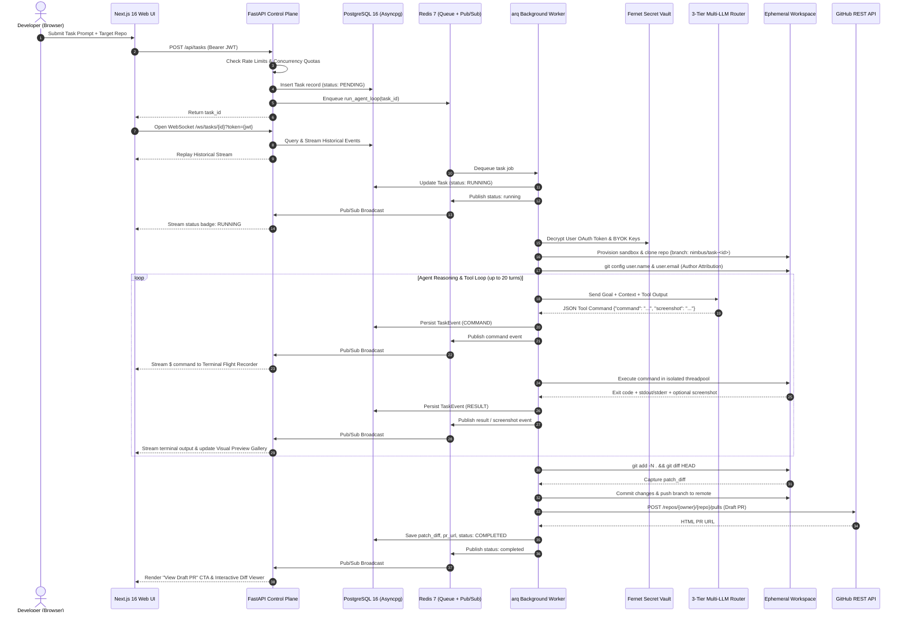

# Nimbus — System Architecture & Design Specification

> **Autonomous Cloud Software Engineering Agent Platform**  
> *Architected for Zero-Trust Sandbox Isolation, Multi-Tenant Security, Multi-Tier LLM Resilience, and Append-Only Flight Telemetry.*

---

## 1. System Overview & Executive Summary

**Nimbus** is a Devin-style autonomous cloud software engineering platform. Developers delegate natural-language coding tasks via a modern web interface. A trusted cloud control plane provisions an isolated, disposable sandbox to inspect repositories, write code modifications directly to disk, execute test suites, capture tested patches, and open verified GitHub Pull Requests.

```
                                  [ Developer Browser ]
                                           │
                                           ▼
                       [ Frontend: Next.js 16 (App Router / Turbopack) ]
                         (Dark Glassmorphic UI / Replay / Lightbox)
                                           │
                       ┌───────────────────┴───────────────────┐
                       │ HTTPS REST / OAuth                    │ WSS Authenticated Stream
                       ▼                                       ▼
               [ Backend: FastAPI Control Plane Gateway (Render / Cloud) ]
                       │                                       │
       Postgres Async  │                       Distributed     │ Pub/Sub &
       Connection Pool │                       Event Bus       │ Stream Fan-Out
                       ▼                                       ▼
          [ PostgreSQL 16 (Neon / Supabase) ]        [ Redis 7 (Upstash / Cloud) ]
          • Users & Encrypted Credentials            • arq Job Queue
          • Tasks & Append-Only Event Stream         • Real-Time Flight Fan-Out
                       ▲                                       ▲
                       │ Async State Updates                   │ Dequeue Job
                       │                                       │
               [ Background Worker: arq Worker Process ]
                       │
       ┌───────────────┼───────────────────────────────┐
       ▼               ▼                               ▼
[ 3-Tier Multi-LLM ] [ Ephemeral Sandbox ]      [ GitHub REST API ]
  • Gemini 3.6/3.7     • Docker / Linux cgroups   • Dynamic Repos
  • Groq 120B          • Subprocess (Fallback)    • Feature Branches
  • OpenRouter Free    • MicroVM (Phase 5)        • Automated Draft PRs
```

---

## 2. Core Architectural Pillars

### 2.1. Hexagonal Control-Plane vs. Data-Plane Separation
The orchestrator lives **strictly outside** the untrusted workspace. The control plane manages task lifecycle, authentication, secret decryption, and LLM reasoning. The execution data plane (the sandbox) has no access to control-plane credentials, database connections, or LLM API keys. Commands are executed over isolated pipes (`docker exec` or `subprocess.run`).

### 2.2. Zero-Trust Ephemeral Sandboxing
Every task executes inside a fresh, disposable environment configured with hard resource limits (`1 GB` RAM, `2.0` CPUs, `256` PIDs, dropped capabilities `ALL`, `no-new-privileges:true`, and a 300-second per-command watchdog). Environments are purged immediately upon task completion or cancellation.

### 2.3. Resilient 3-Tier Multi-LLM Fallback Router
To guarantee 99.9% uptime despite third-party provider outages, rate limits, and 429/503 spikes:
- **Tier 1 (Primary)**: Google Gemini pool (`gemini-3.6-flash`, `gemini-3.7-flash`, `gemini-3.5-flash`, `gemini-flash-latest`) via `google-genai` async client.
- **Tier 2 (Secondary)**: Groq (`openai/gpt-oss-120b`) with context window truncation (5,500 tokens) to stay within the 8k TPM cap.
- **Tier 3 (Tertiary)**: OpenRouter (`cohere/north-mini-code:free` or `google/gemma-4-31b-it:free`).

### 2.4. Append-Only Event Sourcing & Distributed Fan-Out
All state mutations (logs, bash commands, exit codes, stdout/stderr chunks, visual screenshots, and status transitions) are persisted to PostgreSQL as immutable `TaskEvent` rows. Real-time updates fan out across horizontally scaled API replicas via **Redis Pub/Sub & Streams**. Connecting WebSocket clients instantly receive full historical replay.

### 2.5. Server-Backed Encrypted Credential Vault & BYOK Routing
Developer GitHub OAuth tokens and optional BYOK (Bring-Your-Own-Key) provider keys (`gemini`, `groq`, `openrouter`, `github_pat`) are encrypted at rest using **Fernet AES-256** (`DATABASE_SECRET_KEY`). Client-side storage of sensitive credentials is strictly eliminated.

---

## 3. End-to-End Execution Sequence Flow



---

## 4. Trust Boundaries & Security Architecture

```mermaid
graph TD
    subgraph Trusted Zone ["🔒 Trusted Control Plane (Control Plane & Infrastructure)"]
        UI["Web Frontend\n(Next.js 16 App Router)"]
        API["FastAPI Control Plane Gateway\n(REST & WebSockets)"]
        DB[("PostgreSQL 16\n(Users, Vault, Tasks, Events)")]
        Redis[("Redis 7\n(arq Queue, Pub/Sub, Streams)")]
        Worker["arq Background Worker Process"]
        Vault["Fernet AES-256 Vault\n(Encrypted BYOK & OAuth Tokens)"]
        LLM["3-Tier LLM Router\n(Gemini, Groq, OpenRouter)"]
    end

    subgraph Untrusted Zone ["⚠️ Untrusted Disposable Sandbox (Data Plane)"]
        Container["Disposable Sandbox (Docker / Subprocess)\n• Memory Cap: 1 GB\n• CPU Cap: 2.0 Cores\n• PIDs Limit: 256\n• Cap Drop: ALL\n• No New Privileges\n• Timeout: 300s"]
        Repo["/workspace/repo\nCloned Repository Code"]
        Tools["Toolchain\n(git, python3, build-essential)"]
    end

    UI <-->|HTTPS / WSS (JWT Auth)| API
    API <-->|asyncpg pool (20 conn)| DB
    API <-->|Redis Pub/Sub / Streams| Redis
    Redis <-->|Job Dispatch| Worker
    Worker <-->|State Updates| DB
    Worker --- Vault
    Worker <-->|Async REST / SDK| LLM
    Worker -->|docker exec / isolated pipe| Container
    Container --- Repo
    Container --- Tools
    Worker -->|Transient Auth Header| GitHub["GitHub REST API\n(Draft Pull Requests)"]
```

### Security Controls Matrix

| Attack Vector | Vulnerability Risk | Nimbus Mitigation Strategy |
| :--- | :--- | :--- |
| **Credential Theft in Repo** | Malicious script in repository reads environment secrets | Control plane holds all keys. Secrets are **never** injected into sandbox environment variables or `.git/config`. |
| **Sandbox Escape / Privilege Escalation** | Container breakout attacking host system | `cap_drop=["ALL"]`, `security_opt=["no-new-privileges:true"]`, `pids_limit=256`, non-root execution. |
| **Denial of Service / Fork Bombs** | Infinite loops, heavy compilation, or fork bombs | Hard cgroup limits (`1 GB` RAM, `2.0` CPUs, `256` PIDs) and strict per-command execution timeouts (`timeout 300`). |
| **LLM Provider Outages / Rate Limits** | 429 quota exhaustion or 503 provider downtime | 3-tier hierarchical router with intra-model Gemini failover, Groq context truncation, and OpenRouter backup. |
| **Session Hijacking / Stream Snooping** | Unauthorized users observing competitor flight logs | Authenticated WebSocket handshakes verifying JWT tokens and owner-scoped database queries (`user_id`). |
| **Noisy Neighbors / Sandbox Monopolization** | Single user submitting hundreds of concurrent tasks | Multi-tenant sliding window rate limiter (Free: 3 concurrent / 20 hr; Pro: 10 concurrent / 100 hr). |

---

## 5. Architectural Trade-Off Analysis

| Architectural Decision | Chosen Strategy | Alternative Rejected | Rationale & Trade-Off |
| :--- | :--- | :--- | :--- |
| **Orchestrator Placement** | Out-of-Sandbox Control Plane | In-Sandbox Agent Process | Running the agent inside the sandbox simplifies tool execution but exposes LLM API keys and database credentials to untrusted code. |
| **Workspace Lifecycle** | Ephemeral per-task sandbox | Stateful persistent container | Ephemeral containers prevent cross-task contamination and eliminate persistent storage costs, at the minor cost of cloning per task. |
| **Git Credential Injection** | Transient `http.extraheader` | Persisted `.git/config` token | Prevents long-lived credential leakage in the workspace filesystem if a user inspects git configuration. |
| **Event Persistence** | PostgreSQL Append-Only Stream | Ephemeral In-Memory State | Enables full historical session playback on browser disconnects, compliance audits, and post-flight debugging. |
| **Event Broadcasting** | Redis Pub/Sub + Streams | Local In-Process Memory Bus | Enables horizontal scaling of FastAPI gateway replicas across distributed cloud instances without dropping events. |
| **LLM Reasoning Format** | Structured JSON with Bash Tools | Native Python Functions / LSP | Standard bash tool invocation gives universal flexibility across all languages without requiring heavy language servers. |
| **Visual Verification** | Base64 Artifact Extraction | Heavy Full-VNC Streaming | Binary base64 snapshot capture provides instant visual feedback without the bandwidth and compute overhead of a full VNC stack. |

---

## 6. Technical Stack & Component Contracts

### 6.1. Backend Control Plane (`backend/`)
- **FastAPI 0.141+**: Asynchronous ASGI REST API and WebSocket gateway.
- **SQLAlchemy 2.0 + asyncpg**: Connection-pooled asynchronous PostgreSQL ORM (`pool_size=20`, `max_overflow=10`, `pool_pre_ping=True`).
- **Alembic**: Zero-downtime database schema migrations (`b2c3d4e5f6a7`, `c3d4e5f6a7b8`).
- **arq 0.26+ & Redis 7**: Non-blocking asynchronous job queue and distributed event bus.
- **Cryptography (Fernet AES-256)**: Encryption of user OAuth tokens and BYOK credentials at rest.
- **Google GenAI SDK & HTTPX**: Asynchronous multi-turn LLM reasoning clients.

### 6.2. Frontend Web Console (`frontend/`)
- **Next.js 16 (App Router) & React 19**: Server and client component architecture with Turbopack.
- **CSS Modules & Dark Glassmorphism**: High-contrast, tactile UI with custom SVG vector icons.
- **3-Tab Task Inspector**: Terminal Flight Recorder, Interactive Patch Diff Viewer, and Visual Preview Gallery with Lightbox modal.
- **AuthContext & OAuth Navigation**: Automatic session token management and 1-click GitHub Sign-In.

---

## 7. Cloud Production Deployment Topology

Nimbus is deployed across a multi-service modern cloud infrastructure:

- **Frontend**: [Vercel](https://vercel.com) Edge Network (`https://nimbusagent.vercel.app`) with Next.js 16.
- **Control Plane API**: [Render](https://render.com) Web Service (`nimbus-api`) running FastAPI via Uvicorn.
- **Background Worker**: [Render](https://render.com) Background Worker (`nimbus-worker`) running `arq`.
- **Database**: [Neon](https://neon.tech) Serverless PostgreSQL 16 with connection pooling.
- **Distributed Event Bus & Queue**: [Upstash](https://upstash.com) Managed Redis 7 (TLS enabled).
- **Monitoring**: UptimeRobot keep-alive pings against `GET /api/health` ensuring zero cold starts.

---

## 8. Evaluation Benchmark & Verification Architecture

Nimbus incorporates an autonomous software engineering benchmark suite (`backend/evals/eval_runner.py`):
1. **Synthetic Multi-Turn Benchmark**: Evaluates code inspection, edge-case fixing, test assertions, and format self-correction.
2. **Live Filesystem Workspace Benchmark**: Provisions real disk repositories, injects buggy code, executes real unittest runners, verifies disk fixes, and validates git diff outputs.
3. **Continuous Regression Testing**: 46 comprehensive Pytest unit and integration tests covering API routes, authentication, credential vaults, LLM failovers, event streaming, and workspace sandboxing.

---

## 9. Future Architectural Evolutions

1. **Phase 5: Unified WorkspaceProvider & MicroVM Sandboxes**: Protocol abstraction supporting local Docker, Subprocess fallback, and cloud MicroVMs (Fly Machines / Firecracker / Modal).
2. **Phase 6: Interactive Human-in-the-Loop Steering**: Mid-flight user prompt injection, step-by-step destructive command approvals, and terminal attach.
3. **Phase 7: Semantic Code Indexing & LSP Support**: Tree-sitter AST symbol graphs, vector embeddings for large repositories, and real-time diagnostic feedback.
